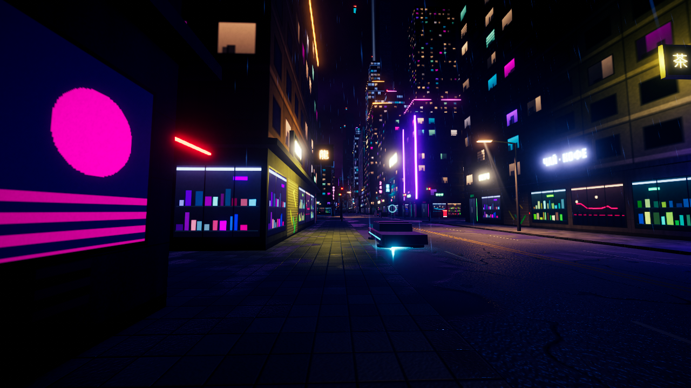
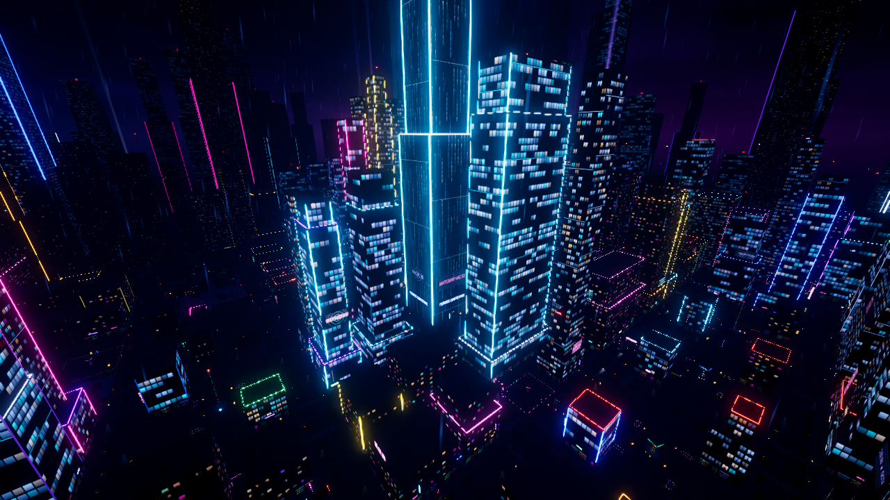
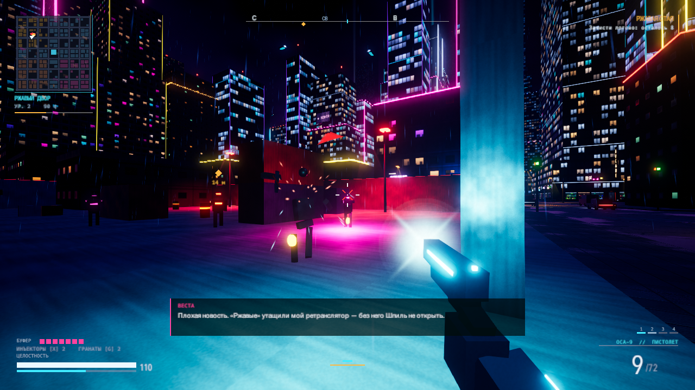
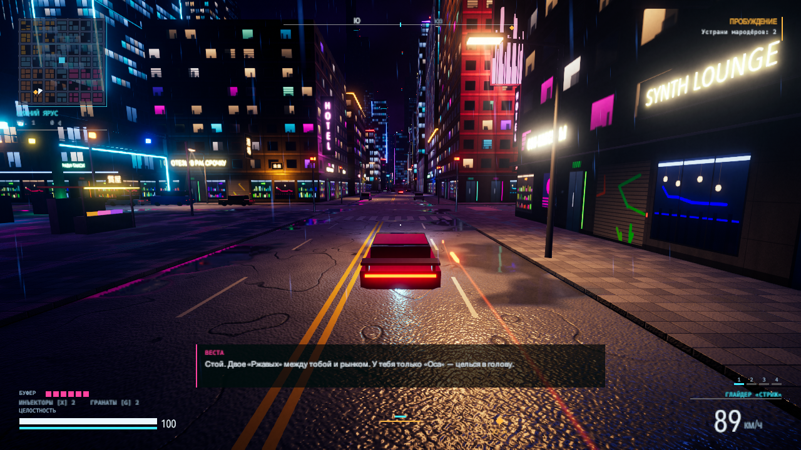
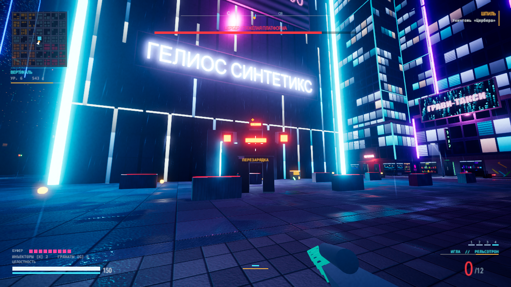

# Neon Meridian

Оригинальный киберпанк-экшен от первого лица на Unity 6 (URP). Жанр и механики — как у больших
игр про неоновые мегаполисы, но сеттинг, персонажи и весь контент свои: город Меридиан, корпорация
«Гелиос Синтетикс», банда «Ржавые» и куратор Веста.

В проекте нет ни одного импортированного ассета: город, текстуры, вывески, модели, звук и музыка
создаются кодом при загрузке.



| | |
| --- | --- |
|  |  |
|  |  |

Остальные кадры — в `Screenshots/`.

## Скачать и запустить

Готовая сборка для macOS (Apple Silicon, macOS 12 и новее) лежит на странице
[Releases](https://github.com/barkovkd/neon-meridian/releases/latest): скачайте архив, распакуйте и
запустите `Neon Meridian.app`.

Приложение не подписано сертификатом разработчика Apple, поэтому при первом запуске macOS его
заблокирует. Откройте «Системные настройки → Конфиденциальность и безопасность» и нажмите «Всё равно
открыть» либо снимите карантин в Терминале:

```bash
xattr -dr com.apple.quarantine "Neon Meridian.app"
```

Собрать приложение из исходников можно скриптом `bash Tools/build.sh` — см. раздел «Как открыть и
собрать».

## Что есть в игре

- Район 600 × 600 м: 49 кварталов четырёх типов застройки, башня «Гелиос», рынок, логово банды,
  площади с ретрансляторами; мокрый асфальт с отражениями, дождь, молнии, туман, неон.
- Живой город: машины со светофорами, потоки аэрокаров, прохожие, голограммы, пар из люков.
- Бой: пистолет, ПП, дробовик, рельсотрон, клинок, гранаты; рывок, подкат, двойной прыжок,
  «фокус» (замедление времени), щит и инъекторы.
- Транспорт: ховер-глайдер «Стриж» у точки старта — можно сесть за руль (`E`), есть форсаж и ручник.
- Сканер и взлом: метки врагов сквозь стены и четыре эксплойта (перегрузка, ослепление,
  перехват дронов и турелей, детонация).
- Семь типов противников: мародёр, потрошитель, бастион, легионер, дрон, турель и босс «Цербер».
- Сюжет из четырёх заданий, уровни, кредиты, торговец с оружием и имплантами, свободная игра после финала.

## Управление

| Действие | Клавиши |
| --- | --- |
| Ходьба, бег, прыжок | `W A S D`, `Shift`, `Пробел` |
| Присесть / подкат на бегу | `Ctrl` или `C` |
| Рывок | `Q` |
| Огонь, прицел, перезарядка | `ЛКМ`, `ПКМ`, `R` |
| Оружие | `1`–`4` или колесо |
| Клинок, граната, инъектор | `V`, `G`, `X` |
| Фокус (замедление времени) | `F` |
| Сканер | удерживать `Tab`, эксплойты — `1`–`4` |
| Взаимодействие, фонарь, пауза | `E`, `L`, `Esc` |
| За рулём | `W S` — газ и тормоз, `A D` — руль, `Shift` — форсаж, `Пробел` — ручник, `E` — выйти |

Геймпад тоже поддерживается (стики, триггеры, `A` — прыжок, `LB` — рывок).

## Качество и скорость

Уровень «КАЧЕСТВО КАРТИНКИ» в настройках (НИЗКОЕ / СРЕДНЕЕ / ВЫСОКОЕ) задаёт не масштаб, а бюджет
пикселей для 3D: примерно 0,8, 1,3 и 2,2 млн. Картинка подгоняется под него на любом экране —
в том числе на retina в режиме «больше места», где полный экран это 3840 × 2410, — а интерфейс
всегда рисуется в полном разрешении. Рядом с названием уровня показано фактическое разрешение 3D.

Если кадры идут медленнее примерно 42 в секунду, игра сама уменьшает разрешение 3D (до 40 % бюджета),
а через некоторое время осторожно пробует вернуть его. Раз в 20 секунд частота кадров пишется в лог:
`~/Library/Logs/Meridian Works/Neon Meridian/Player.log`.

## Как открыть и собрать

Версия редактора: **Unity 6000.6.7f1**, конвейер URP.

- **Собрать игру:** `bash Tools/build.sh` — запускает редактор в пакетном режиме и кладёт готовое
  приложение в `Builds/Neon Meridian.app`. Первая сборка занимает несколько минут, следующие — около
  40 секунд.
- **Открыть в редакторе:** добавьте папку проекта в Unity Hub. При первом открытии выполнится
  `Neon Meridian > Setup Project` (материалы-шаблоны, профиль постобработки, сцена
  `Assets/Scenes/Main.unity`). Дальше — Play.

Unity не работает с проектом на диске exFAT или FAT (база ассетов требует «родную» файловую систему).
Если проект лежит на таком диске, `Tools/build.sh` сам копирует его в рабочую папку на внутреннем
диске (`~/Library/Caches/NeonMeridian/Project`, около 1,1 ГБ вместе с кэшем Unity; её можно удалять
в любой момент), собирает там и возвращает результат. Чтобы открыть такой проект в редакторе, его
нужно скопировать на внутренний диск. Пути к редактору и рабочей папке задаются в `Tools/local.env`
(образец — `Tools/local.env.example`).

Меню редактора: `Neon Meridian > Setup Project` и `Neon Meridian > Build macOS App`.

## Как устроен проект

```
Assets/
  Editor/NeonMeridianSetup.cs   настройка проекта и сборка
  Resources/Shaders/            свои шейдеры: экраны, голограммы, небо, аддитив
  Scripts/
    Core/        GameDirector (точка входа), ввод, слои, генератор случайных чисел
    Rendering/   процедурные текстуры, меши, материалы, запекание текста, постобработка, погода
    World/       генератор города, вывески, свет, транспорт, прохожие, предметы
    Player/      контроллер, оружие, сканер, взаимодействие
    Combat/      урон, снаряды, эффекты
    Vehicles/    глайдер игрока
    AI/          противники и босс
    Missions/    сюжет
    UI/          HUD и меню
    Audio/       синтезатор, банк эффектов, музыка
    Dev/         автотест
```

Вся игра строится из одной почти пустой сцены: объект `GameDirector` генерирует город по зерну
(поле `seed` в инспекторе) и создаёт остальное.

## Автотест

Сборку можно прогнать без участия человека — бот сам играет, снимает кадры и пишет `report.txt`:

```
"Neon Meridian.app/Contents/MacOS/Neon Meridian" -autotest -autotest-script play -autotest-out /путь/к/папке
```

Сценарии: `title` (титульный экран и меню), `play` (движение, бой, сканер, торговец, пауза, гибель),
`story` (весь сюжет на перемотке), `drive` (поездка на глайдере), `tour` (облёт района), `audio`
(замер громкости всех синтезированных звуков).

Полезные флаги: `-batchmode` — без окна (кадры всё равно снимаются), `-autotest-act N` — начать сюжет
с задания N, `-autotest-sound` — не отключать звук (по умолчанию автотест молчит).
